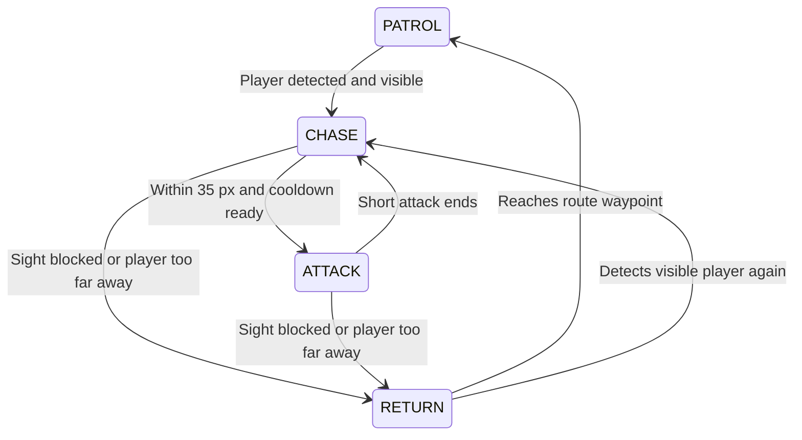

# SECTOR-09 — Club Interview Study Guide

**Project:** a browser-based tactical stealth arcade game. Collect data, hide behind cover, avoid patrols and survive Warden waves.

**Live game:** https://sector-09.vercel.app/

This guide describes the actual implementation in this repository. Examples labelled “simplified” explain the idea; open the linked source for the full implementation.

## 1. Your one-minute introduction

> “SECTOR-09 is a tactical stealth game built with HTML, CSS and vanilla JavaScript. I used Canvas 2D for procedural graphics and the Web Audio API for music and effects. Enemy behavior uses a finite-state machine, with line-of-sight checks so walls provide real cover. A fixed 120 Hz simulation is separated from rendering. The game supports keyboard and phone joystick controls, escalating difficulty and Warden waves. GitHub stores the source and Vercel hosts the static website. I used Codex for AI-assisted implementation and testing, while directing the features and reviewing their behavior.”

Use your own words. Be clear about AI assistance and which parts you personally understand or changed. You do not need to claim you wrote every line manually to explain the project well.

**Core challenge:** keeping movement, collisions, enemy vision, audio and mobile controls consistent, especially during pause and difficulty transitions.

## 2. What technologies and tools did we use?

| Technology/tool | Its job here |
| --- | --- |
| HTML5 | Page structure, Canvas element, menus and accessible controls |
| CSS3 | Layout, animations, themes, responsive media queries and safe-area padding |
| Vanilla JavaScript | Game rules, classes, events, vectors, collision and enemy AI |
| Canvas 2D API | Draw walls, ships, vision areas, pickups and visual effects |
| Web Audio API | Generate BGM, siren and effects using oscillators and gain nodes |
| `requestAnimationFrame` | Schedule rendering with the browser |
| Pointer Events | Phone joystick, dragging, pointer capture and cancellation |
| Fullscreen API | Optional fullscreen through the button or F key |
| `localStorage` | Save preferences and per-mode high scores on this browser |
| `sessionStorage` | Remember music activation and sequence position between pages |
| Node.js 22+ | Local HTTP server, automated tests and browser automation |
| npm | Run commands such as `npm start` and `npm run test:all` |
| Node test runner/assertions | Verify behavior without an external test framework |
| Chrome DevTools Protocol (CDP) | Browser tests, dispatched keyboard/touch input and screenshots |
| Git | Track changes as commits |
| GitHub | Host the remote source repository and history |
| Vercel and its CLI | Publish static files, configure redirects and response headers |
| Codex | AI-assisted coding, debugging and QA |
| PowerShell | Run development, Git and deployment commands on Windows |

**Stack in one line:** HTML + CSS + JavaScript + Canvas + Web Audio; Node.js for tooling; GitHub for source; Vercel for hosting.

### Important distinctions to remember

- No React, Next.js, Phaser, Unity or Three.js is used.
- There are **no runtime npm dependencies**. npm runs commands; its presence does not imply a framework.
- There is no custom production backend, database, login or global leaderboard.
- Node.js runs development/test tools. Players run the game in their browser.
- Enemy “AI” is **rule-based behavior and pathfinding**, not machine learning.
- Graphics and sound are mostly procedural, rather than downloaded sprite/MP3 assets.

## 3. Folder structure and files to study

```text
public/                         Published website
  index.html                    Landing/menu page
  pages/                        Play, settings, sound, controls, exit
  assets/
    css/                        Themes, menus, game and error UI
    icons/                      SVG favicon
    js/
      core/                     Startup, settings, themes, diagnostics
      audio/                    Sound generation and site-wide music
      game/                     Models, loop, AI and shared model tests
      ui/                       Menus and touch controls
scripts/serve.cjs               Local HTTP server
tests/                         Unit, project, browser and play-session tests
docs/                          Architecture, release QA and this guide
package.json                   Commands; no runtime dependencies
vercel.json                    Output folder, redirects and headers
```

**Why separate these?** Rules should not be duplicated across pages, audio should have one owner, and tests/documentation should stay outside the published website.

Open these beside the guide:

- [Game models and loop](../public/assets/js/game/game.js)
- [Touch controls](../public/assets/js/ui/touch-controls.js)
- [Sound system](../public/assets/js/audio/sound-system.js)
- [Site-wide audio](../public/assets/js/audio/site-audio.js)
- [Startup validation](../public/assets/js/core/bootstrap.js)
- [Preferences](../public/assets/js/core/preferences.js)
- [Error handling](../public/assets/js/core/errors.js)
- [Browser tests](../tests/browser.cjs)

## 4. What happens when someone opens the game?

```text
HTML loads
  → diagnostics load first
  → preferences and theme load
  → sound, game and input scripts load
  → bootstrap validates modules, controls and Canvas support
  → one Game instance is created
  → READY screen appears
  → player starts
  → reset initializes the world
  → RUNNING simulation and rendering begin
```

`core/bootstrap.js` owns startup. Loading game models in a test therefore does not accidentally launch a real game.

Classic scripts expose small namespaces such as `Sector09`, `SectorAudio` and `SectorPreferences`. Some files also use CommonJS exports so Node tests can load the same implementation. This is not an ES-module/bundler setup.

## 5. Main classes and OOP

| Class | Responsibility |
| --- | --- |
| `Vector2D` | Position/direction math: add, subtract, scale, distance, normalize, interpolate |
| `Obstacle` | Wall geometry, line intersection, collision resolution and drawing |
| `Player` | Movement, heading, health and temporary hit protection |
| `Enemy` | Waypoints, state transitions, sight, navigation, steering and attacks |
| `Boss` | Extends `Enemy` with a larger body and faster bounded movement |
| `FloatingText` | Short-lived `+10` score feedback |
| `Game` | Owns the world, lifecycle, scoring, waves, UI and main loop |
| `SoundSystem` | Owns audio generation and volume buses |

**Encapsulation:** related state and behavior belong together, such as `Player.hp` and `Player.damage()`.

**Inheritance:** `Boss extends Enemy` reuses patrol, collision and sight behavior.

**Polymorphism:** the update loop calls `enemy.movementSpeed(game)` for either type; the boss overrides that method.

**Composition:** `Game` contains and coordinates a player, walls, enemies, pickups and audio.

## 6. The game loop — your most important topic

The browser calls `requestAnimationFrame`. The game measures elapsed real time, accumulates it and advances physics in fixed **1/120-second** steps.

Simplified:

```js
accumulator += Math.min(elapsedSeconds, 0.1);
while (accumulator >= STEP && mode === 'RUNNING') {
  update(STEP);              // STEP = 1 / 120
  accumulator -= STEP;
}
draw();                     // Actual code also avoids unnecessary draws
requestAnimationFrame(frame);
```

`update` validates state, moves the player, updates enemies, handles loss, expires/collects pickups, updates the alert/siren and advances effects.

**Why fixed steps?** Movement and collision stay more consistent when display frame rates vary. The 100 ms catch-up limit prevents a long inactive tab from causing a huge simulation jump.

**Why separate update and draw?** Physics decides what happens; rendering displays it. Phones draw at roughly 60 fps while physics targets 120 updates per simulated second. Static paused scenes redraw only when relevant presentation state changes.

Do not say “the game always runs at 120 FPS.” Simulation frequency and displayed frame rate are different. Slow hardware can still miss its performance budget.

## 7. Movement and vector math

```text
displacement = velocity × elapsed time
```

Player speed is **170 logical pixels/second**. A fixed step moves approximately `170 / 120 = 1.42` pixels at full speed.

Right input is `(1, 0)`, length 1. Right + up is `(1, -1)`, length `sqrt(2) ≈ 1.414`. Without normalization, diagonal movement is about 41% faster.

Divide a nonzero direction vector by its length, then multiply by speed. Handle the zero vector separately to avoid division by zero.

Held keys are tracked in a `Set`, so movement depends on current input rather than operating-system key-repeat speed.

Enemy velocity is smoothed using interpolation with a factor like `1 - exp(-12 * dt)`. The smoothing responds to elapsed time rather than applying a fixed percentage per display frame.

## 8. Collision detection and wall sliding

Bodies use circular hitboxes; walls are axis-aligned rectangles (**AABBs**). Artwork and collision shapes are related but not identical.

For circle-versus-wall overlap:

1. Clamp the circle center to the rectangle bounds to find the nearest point.
2. Measure the distance from that point to the center.
3. If it is smaller than the radius, push the body out of the overlap.

A center embedded inside a wall is pushed toward the nearest wall face. Resolving movement on X and Y allows sliding along walls.

Large movements are split into small substeps to reduce **tunneling**: jumping through an obstacle between two simulated positions. Arena bounds also account for body radius.

This is custom collision code, not a third-party physics engine.

## 9. Enemy AI: the finite-state machine

An **FSM** has a current state and explicit rules for transitioning to another state.



- **PATROL:** follow predefined waypoints.
- **CHASE:** pursue a visible player.
- **ATTACK:** perform a short lunge and apply damage only on valid contact.
- **RETURN:** navigate back to a patrol waypoint.

### Hysteresis

Medium mode initially detects at **160 px**, but an existing chase can continue to **210 px** in open space. Different enter/exit thresholds prevent rapid state flickering near one boundary. This is called hysteresis.

The wider range never grants vision through walls. Cover immediately breaks pursuit, even inside that range.

## 10. How cover blocks sight

The code checks the segment from enemy to player against every wall using **slab clipping**. It finds the segment-parameter interval inside the rectangle's X bounds and intersects that with the interval inside its Y bounds.

If those intervals overlap within the segment, the wall blocks sight.

```text
visible = within current sight range AND no wall intersects sight segment
```

The drawn vision area also stops at walls. Ray casting includes regular directions plus angles just around wall corners, producing obstacle silhouettes. Drawing and detection use the same current range.

Drawing a red circle alone would not implement vision; the geometric visibility check controls detection.

## 11. Pathfinding versus steering

**Pathfinding:** find a route around obstacles. **Steering:** decide how to move toward its next point.

`findPath()` first checks for a direct clear route. Otherwise, it builds a visibility graph from start, goal and wall corners expanded for body clearance. Four walls give at most **18 vertices**.

Clear segments connect vertices; Euclidean distance is their cost. **Dijkstra's algorithm** finds a shortest available route. The implementation scans an array for the next minimum-distance vertex. It does not use A*, an A* heuristic or a priority queue.

Five “whisker” probes sample forward and angled directions. Blocked probes are penalized; interpolating velocity smooths the selected movement.

**Why this algorithm?** The graph is tiny, so a simple implementation is sufficient. A large generated tile map could justify evaluating grid-based A* or another navigation representation.

**Why aim at contact distance instead of the player's exact center?** A player beside cover can create an unreachable target for a larger enemy. An approach-side contact target avoids freezing while still permitting a valid attack.

## 12. Whole-game states are different from enemy states

| Game state | Meaning |
| --- | --- |
| `READY` | Waiting to start |
| `RUNNING` | Advance gameplay and timers |
| `PAUSED` | Ordinary pause menu |
| `WARDEN_INTRO` | First-Warden briefing; wait for Continue |
| `OVER` | All three health points lost |
| `ERROR` | Fatal failure; stop and offer recovery |

During pause/briefing, the normal frame loop does not call gameplay updates. Movement, attacks and pickup countdowns freeze together. Music can continue because its scheduler is independent.

The briefing appears once **per run**, not once forever. Continue resumes the current world rather than resetting score or restarting.

## 13. Pickups, difficulty and Warden rules

- Each run maintains **2 or 3 pickups**.
- Each awards **10 points** and lasts about **10–14 simulated seconds**.
- A shrinking ring shows remaining time; expiration awards nothing.
- Collected or expired pickups are replaced.
- Placement avoids walls, nearby units, other pickups and visible UI controls.
- Placement uses bounded random attempts followed by a grid search, not an unlimited retry loop.

Threat level:

```js
1 + Math.floor(score / 50)
```

The speed multiplier grows at a mode-specific rate and caps at **3×**. Per-state movement caps also prevent absurd speeds in long runs.

| Score | Enemy roster |
| --- | --- |
| 0–49 | Initial guards: Easy 1, Medium 2, Hard 3, God 5 |
| 50–99 | Add a regular guard if below the cap of 5 |
| 100–149 | Replace normal guards with 1 Warden; first-arrival briefing |
| 150–199 | Replace that wave with 2 Wardens |
| 200–299 | Normal patrols return at the current threat level, capped at 5 |
| 300–399 | Repeat the one-Warden and two-Warden waves |

`score % 200` identifies the part of the repeating cycle. Wardens traverse the perimeter and central lanes; the second follows the route in reverse.

Warden chase is **204–306 px/s**, faster than the player's 170. The counterplay is hiding and breaking sight, not winning a straight-line race. **God mode is the hardest mode, not invincibility.**

All modes start with 3 health points. A short invulnerability window after damage prevents continuous contact from draining all health instantly. Attack cooldown and player hit recovery are separate controls.

## 14. Phone controls and responsive layout

The logical world stays **800×600**. CSS `object-fit: contain` preserves aspect ratio and collision geometry. Spare viewport space becomes gutters instead of stretching the world.

Wide phones place telemetry/actions in those gutters. Media queries use screen width, height, orientation and aspect ratio. Safe-area padding protects controls near notches.

The joystick converts pointer offset into direction and strength. A radial **0.14 deadzone** ignores tiny thumb movements; clamping prevents a speed boost when dragging beyond its base.

**Pointer capture** tracks a drag outside the original control. Release, cancellation, lost capture, blur and rotation clear input. Secondary buttons act on touch `pointerdown` and suppress the later duplicate click.

`nodeVisibility()` projects world coordinates into screen coordinates, accounting for scale and gutters, then excludes rectangles occupied by visible controls. A pickup should not spawn invisibly beneath the joystick or HUD.

## 15. How sound is generated

```text
oscillator → envelope gain → effects/music/siren bus → master gain → speakers
```

- An oscillator generates a waveform such as sine or triangle.
- Frequency controls pitch; gain controls signal amplitude.
- A short envelope fades a note in/out to avoid abrupt clicks.
- Separate buses allow independent effects, siren, music and master volumes.

The siren uses a **420 Hz triangle carrier**, modulated approximately **±120 Hz at 0.8 Hz**, producing a sweep around 300–540 Hz.

BGM is a **16-step minor pattern at 88 BPM**. Notes are scheduled slightly ahead on the audio clock. A JavaScript interval feeds that schedule rather than defining exact audible timing itself.

Audio starts/resumes after an accepted interaction because browsers restrict autoplay. If it fails, the game reports the problem and continues silently.

One sound instance is shared per document. Full-page navigation recreates the audio context and restores activation/pattern position through session storage. Do not claim perfectly gapless music between independent HTML pages.

## 16. Themes, storage and the backend question

CSS variables define menu/HUD colors; matching JavaScript palettes define Canvas colors. Dark/light mode affects presentation, not game rules.

`localStorage` persists validated preferences and per-mode records. `sessionStorage` remembers music activation and sequence position within the tab session.

JSON can be corrupt, storage can be denied, and writes can fail. Preferences are normalized and volumes clamped to 0–1. In-memory fallback keeps the page usable, but those unsaved changes disappear on reload.

**Are scores secure?** They are local records, not trustworthy competitive scores. A user can edit browser storage. A shared leaderboard would need backend validation and an anti-cheat design; a database alone would not make client-submitted scores trustworthy.

## 17. Error handling and accessibility

Startup checks required scripts, controls, navigation destinations and Canvas/animation support. Model code rejects invalid geometry, nonfinite values and unsafe movement.

**Recoverable:** unavailable audio, rejected fullscreen, failed storage. Explain the issue and continue usable gameplay.

**Fatal:** missing required modules or a simulation/render exception. Stop the loop/audio, clear input and offer Reload/Home.

Global `error` and `unhandledrejection` listeners catch unexpected failures. Diagnostics deduplicate repeated issues and keep at most 100 entries. They remain local; no error telemetry is uploaded.

Menus use labelled controls, visible focus, modal dialog semantics, background `inert` state and Tab wrapping. Ctrl/Command/Alt browser shortcuts remain native. Motion preferences are respected. This is not proof of a complete WCAG audit.

## 18. Testing: what was verified?

| Layer | Coverage |
| --- | --- |
| Model/unit | Vectors, collision, sight, FSM, scoring, waves, timers and error cases |
| Project | Asset links, syntax, server routes, deployment rules and icon MIME type |
| Browser integration | Pages, settings, audio, keyboard, touch, dialogs, themes and recovery UI |
| Seeded play sessions | Movement, collection, damage, retries and Warden briefings |
| Production verification | Published files, headers, redirects, 404s and live browser behavior |

There are **22 top-level Node checks**, including the shared **17 model regression cases**. They are not 22 plus 17 independent top-level tests.

Twelve movement-only sessions across four difficulties totalled **36 simulated minutes**. The controller did not teleport the player or inject score/health. Browser checks also dispatched real keyboard and multi-touch events. Automated control is not a substitute for human balance testing.

The tools are Node's built-in runner/assertions and a CDP harness—not Jest, Playwright or Selenium. `OfflineAudioContext` renders audio waveforms to check output and clipping; it cannot verify a physical speaker's sound quality.

```sh
npm start                 # http://127.0.0.1:3000
npm test                  # Unit and project checks
npm run test:play         # Seeded movement sessions
npm run test:browser      # Browser checks; needs Chrome/Chromium
npm run test:all          # Full suite
```

Chrome and Edge checks passed, with phone viewport emulation. Real iPhone/Android, Safari/Firefox, full screen-reader coverage and human difficulty testing remain separate validation work. Synthetic timings do not guarantee real-device FPS.

## 19. GitHub versus Vercel

**Git** tracks changes as commits. **GitHub** stores the remote repository. **Vercel** serves the deployed website to players.

`vercel.json` publishes only `public/`, keeping tests, Git data and documentation outside the website output. It defines response headers and legacy redirects, including `/play.html` → `/pages/play.html`.

Deployment uses the authenticated Vercel CLI. GitHub is not the game runtime or a database. The production application has no custom server process, even though hosting infrastructure serves its files.

## 20. Four debugging stories you can explain

### A. Guards freeze beside cover

**Cause:** navigation demanded excessive destination clearance, and steering looked past the endpoint.

**Fix:** use actual body clearance, an approach-side contact target and a shorter final probe.

**Test:** all 16 wall faces across both enemy types and all four modes.

### B. Late-game Wardens become impossibly fast

**Cause:** exponential speed scaling without a ceiling.

**Fix:** cap multipliers and state-specific speeds while preserving the boss advantage.

**Lesson:** test long-run behavior, not only the first few minutes.

### C. Music still says “on” after mute

**Cause:** audio state changed without refreshing the shared indicator.

**Fix:** notify the UI on playback/settings transitions, avoiding updates every physics step.

### D. Phone controls hide pickups

**Cause:** world-space spawn positions ignored screen-space control rectangles.

**Fix:** use gutters and project candidate positions into the viewport before accepting them.

**Lesson:** fitting the page inside the screen does not automatically make its gameplay usable.

## 21. Likely interview questions and short answers

**Why Canvas rather than moving everything as DOM elements?**
Canvas provides direct drawing control for many moving shapes. HTML remains useful for accessible menus. The tradeoff is that Canvas objects do not automatically provide DOM accessibility or layout.

**Why no game engine?**
The scope is small, so vanilla APIs keep the runtime light and expose the underlying algorithms. The tradeoff is maintaining custom physics, input, audio and navigation.

**Is this multiplayer?**
No. It is single-player with local settings and records.

**Line of sight versus pathfinding?**
Sight asks whether the enemy can see a player. Pathfinding asks how a body can travel through free space. They use related geometry for different decisions.

**What is delta time?**
Elapsed time in seconds. Velocity multiplied by time gives displacement; fixed simulation steps make that calculation predictable.

**Why not use `setInterval` for everything?**
Rendering cooperates with animation frames. Physics uses a fixed-step accumulator. Audio schedules notes on its own clock. Different systems need different timing behavior.

**How do you avoid stuck movement after changing tabs?**
Clear input and pause on focus/visibility changes. Touch also clears on cancellation, lost capture, fullscreen changes and rotation.

**How would you add an enemy type?**
Reuse/extend `Enemy`, define its route and movement/attack behavior, connect its spawning and feedback, then test sight, collision, damage and lifecycle transitions.

**What would you improve next?**
Physical-device and human playtesting first. Then evaluate more arenas, onboarding and measured difficulty tuning. Larger maps may need a different navigation representation. Add a backend only for features that need it, such as validated shared records.

**What was your contribution if AI helped?**
Explain the features you directed, the behavior you reviewed and the algorithms you can demonstrate. Separate AI-assisted implementation from your own decisions and verified understanding.

## 22. Preparation plan

### If you have only 45 minutes

1. Learn the stack and practice the one-minute introduction.
2. Understand the game loop, diagonal normalization and enemy FSM.
3. Explain collision, cover and pathfinding as three distinct systems.
4. Learn the Warden cycle, pause behavior and storage limitations.
5. Prepare two debugging stories and an honest explanation of AI assistance.

### If you have another two hours

1. Trace `start → reset → frame → update → collect` in `game.js`.
2. Trace `Enemy.update → decide → findPath → steer → moveBody`.
3. Identify the browser APIs in the sound and touch modules.
4. Run the tests and read one regression case from start to finish.
5. Temporarily change `PLAYER_SPEED` locally, predict the behavior, test it and restore the value. No production deployment is needed for an interview experiment.
6. Rehearse a three-minute demo: movement, cover, theme/settings, phone controls, Warden briefing and diagnostics.

### Explain these without reading before the interview

- [ ] The stack, and why no framework/database/backend was needed.
- [ ] Fixed simulation updates versus displayed frame rate.
- [ ] Why diagonal movement must be normalized.
- [ ] Circle/rectangle collision and substeps.
- [ ] The four enemy states and sight hysteresis.
- [ ] Dijkstra pathfinding versus local steering; no machine-learning AI.
- [ ] Why cover stops pursuit and the siren immediately.
- [ ] One Warden at 100, two at 150, normal patrols at 200.
- [ ] Browser audio restrictions and local/session storage differences.
- [ ] What automated tests prove, and what still needs device/human validation.

**Best preparation:** open the code beside this guide and explain one complete frame aloud. Understanding the chain of events is more useful than memorizing technology names.
